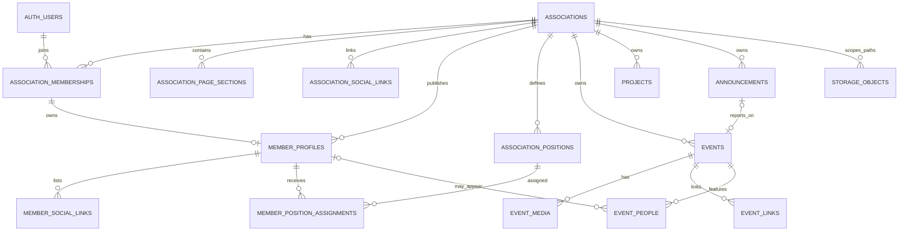

# Association database model

This is the first-release relationship and query plan for the declared schema in `supabase/schemas/public/`. `TODO1.md` contains the role/access matrix and remaining rollout checks.

## Entity relationships

Every association-owned relation carries `association_id`. Composite foreign keys enforce that an event child, position assignment, profile, or report belongs to the same association as its parent. Association rows are archived; foreign keys restrict physical deletion while children exist. Storage objects are managed through Supabase Storage, not SQL foreign keys.

## Public route convention

Use a stable association slug as the first path segment after the locale prefix. Keep route segments the same in both languages so language switching changes only the `/en` prefix and preserves the requested page:

- French association page: `/associations/<association_slug>/`
- English association page: `/en/associations/<association_slug>/`
- Event: `/associations/<association_slug>/events/<event_slug>/` and `/en/associations/<association_slug>/events/<event_slug>/`
- Project: `/associations/<association_slug>/projects/<project_slug>/` and `/en/associations/<association_slug>/projects/<project_slug>/`
- Announcement: `/associations/<association_slug>/announcements/<announcement_slug>/` and `/en/associations/<association_slug>/announcements/<announcement_slug>/`
- Member directory: `/associations/<association_slug>/members/` and `/en/associations/<association_slug>/members/`
- Member: `/associations/<association_slug>/members/<member_slug>/` and `/en/associations/<association_slug>/members/<member_slug>/`

Resolve records using `(association_id, slug)` after resolving the association slug. Do not use query-string routes or user-supplied HTML. Member directory and profile routes reuse the bilingual association route shell and Netlify rewrites. Public directory queries include only profiles that are actively consented and owned by active members of a published association.

## Public and private query paths

Keep these as bounded queries in `src/services/`, with explicit column selections. Apply the listed filters even though RLS also enforces them. Render database content through DOM text APIs.

| Page or feature | Query shape |
| --- | --- |
| Global events | Select `id, association_id, slug, category, title_fr, title_en, summary_fr, summary_en, starts_at, ends_at, timezone_name, event_status` from `events`; filter `publication_status = 'published'`, `published_at <= now()`, order by `starts_at`, and cap results. Join the published association by ID when showing its name/slug. |
| Association page | Resolve `associations` by unique `slug` and published visibility. Fetch published `association_page_sections` and `association_social_links` by that `association_id`, ordered by `display_order`. Fetch published projects/announcements and upcoming or past events with the same tenant filter. |
| Event detail | Resolve event by `(association_id, slug)` or ID after association resolution. Fetch approved `event_media`, public `event_links`, and consented `event_people` by both `association_id` and `event_id`. Fetch its linked event-report announcement by ID only when it is published. |
| Member page | Fetch a public profile by `(association_id, slug)` only when the association is published and the profile has current consent and an active membership. Fetch public, separately consented social links and active display-position assignments for that profile. Never select membership `user_id`, login email, status, or private submission data. |
| President workspace | Resolve the signed-in user's active membership, then scope every workspace read/write by its `association_id`. Event management selects, inserts, and updates events with that association ID; RLS independently checks the president role and tenant. Do not let the browser choose authorization based on a role title or client-side state. |

Private registrations, attendance, applications, and private contact fields are deferred. If introduced, keep them in separate tables and access them through a narrowly scoped trusted server workflow; do not add them to public page queries.

## Storage model

- Buckets: private `association-drafts` for in-progress uploads and public `association-public` for approved public assets.
- Object path: `<association_uuid>/<record_type>/<record_uuid>/<object_uuid>.<ext>`.
- Accepted formats: JPEG, PNG, WebP; 10 MiB maximum; no SVG. Resize/optimize to a 2560 px maximum edge in trusted processing.
- Presidents can manage only their association's draft paths. A trusted server operation approves/copies assets to the public bucket; public bucket reads are available to anyone with an object URL.
- Postgres stores object paths and metadata. Upload, replace, copy, and delete through the Storage API. Delete an old object after its database reference is updated.

Bucket creation, bucket limits, Storage policies, and the trusted approval endpoint must be implemented and reviewed before enabling uploads. The database migrations do not configure the Storage service.

## Consent and lifecycle notes

- A profile or member link is public only with its own consent timestamp and a public parent association. Ended memberships clear profile and link consent/public flags and close current position assignments. Suspended memberships do not satisfy the public-profile authorization helper; reactivation restores visibility only if consent remains current.
- Public event participants require explicit publication consent. The authenticated client cannot write the consent fields; a trusted workflow must record it.
- Public objects cannot be made private by Postgres RLS. Remove or replace public objects through the Storage API when approval is withdrawn.
- Association and tenant-owned row deletion is restricted to preserve references/history. Membership ending is the normal offboarding action. Auth-user erasure needs a separate workflow before removing the restricting foreign key.
- Validate IANA time-zone identifiers in application code before storing them; SQL currently ensures only that `timezone_name` is nonblank.
